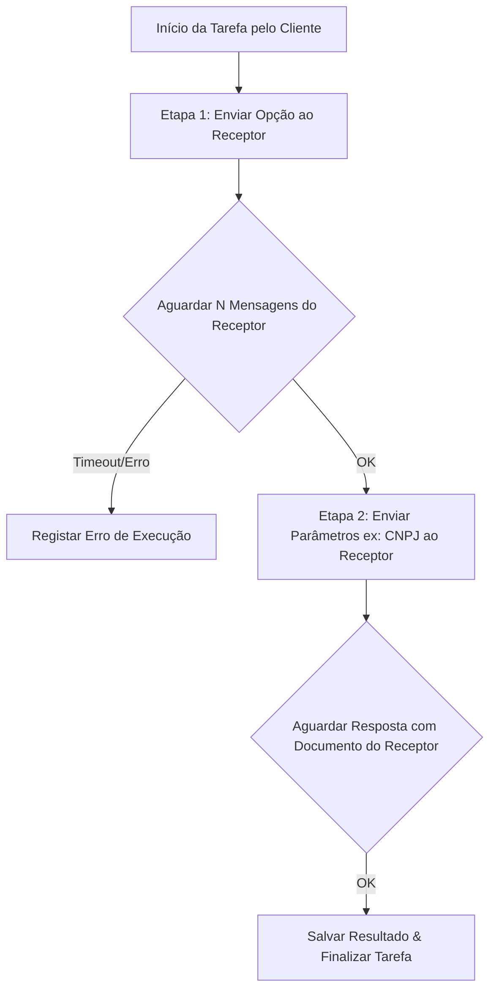

# Regras de Negócio e Arquitetura do Projeto: Orquestrador/Extrator Automático via WhatsApp (wpp_server)

## 1. Definições de Atores e Papéis

- **Cliente**: O número de telefone/celular que **faz a requisição** (inicia ou solicita a ação/automação).
- **Receptor**: O número de telefone/celular que **recebe a requisição** (o robô/sistema de terceiros com o qual o sistema interage para fornecer ou extrair dados).
- **Interação**: A unidade individual do diálogo. É composta pela **Condição de Espera do Receptor** + a **Ação/Resposta do Cliente**:
  - **Condição de Espera do Receptor**: Pode ser por **quantidade de mensagens** ($N$ mensagens recebidas) OU por **conteúdo de mensagem fixa / padrão (Regex)** (ex: aguardar a frase exata *"Digite seu CPF"* ou um link/documento PDF).
  - **Ação/Resposta do Cliente**: Enviar um dado/parâmetro ao Receptor OU disparar a **Ação de Conclusão do Fluxo**.
- **Fluxo de Automação** (ou *Sessão de Diálogo*): A **coleção ordenada de Interações** necessária para concluir um atendimento do início ao fim.
- **Ações de Conclusão / Pós-Processamento do Fluxo**:
  Ao atingir a última etapa do Fluxo, o sistema pode executar automaticamente uma ou mais ações de encerramento:
  1. **Download Automático de Arquivos**: Baixar boletos, PDFs, planilhas ou mídias enviadas pelo Receptor e salvar na pasta local configurada ou no banco de dados.
  2. **Persistência de Dados (Gravar Informação)**: Extrair textos/informações chave da conversa (ex: linha digitável do boleto, protocolo) e salvar no registro da execução do Cliente.
  3. **Disparo de Webhook / Notificação (Opcional)**: Enviar um alerta/notificação local de conclusão da tarefa.
  4. **Transição de Fila**: Marcar o Fluxo atual como `CONCLUÍDO` e iniciar o próximo Fluxo pendente.

> **Exemplo de Aplicação Completa**:
> - **Maria** (Cliente) quer consultar e baixar o boleto no **GOV/Concessionária** (Receptor).
> - **Interação 1**: 
>   - *Espera do Receptor*: 1 mensagem qualquer.
>   - *Resposta do Cliente*: `000.000.000-00` (CPF).
> - **Interação 2**: 
>   - *Espera do Receptor*: Frase `"Digite seu código de cliente"`.
>   - *Resposta do Cliente*: `12345` (Código).
> - **Interação 3 (Finalizador)**: 
>   - *Espera do Receptor*: Envio do arquivo em PDF do Boleto / Link do boleto.
>   - *Ação de Pós-Processamento*: **`[BAIXAR_BOLETO_E_GRAVAR_PROTOCOLO]`** $\rightarrow$ Baixa o PDF do boleto na máquina local, grava o número do protocolo no SQLite e encerra a tarefa.

---

## 2. Visão Geral
O sistema funciona como um **Orquestrador de Tarefas e Extração de Dados via WhatsApp**, focado em automação B2B (ex: contabilidades, sistemas de cobrança, extratores de relatórios de ERPs).
O robô (instalado no celular **Cliente**) precisa disparar e responder mensagens para **múltiplos celulares Receptores** (sistemas de terceiros), onde cada atendimento/processo possui **parâmetros únicos de entrada** e um **fluxo dinâmico de conversação** (árvore de decisão / máquina de estados).

---

## 3. Conceitos-Chave da Regra de Negócio

### 3.1 Multi-Tenant / Multi-Cliente & Carga em Lote (Excel)
- Cada tarefa de automação está associada a um **Cliente** (solicitante) e um celular **Receptor** (alvo).
- **Importação & Modelo Dinâmico de Planilha Excel (.xlsx / .csv)**:
  - **Download de Modelo Exemplo**: Após a criação/configuração de um Fluxo de Automação, o sistema gera dinamicamente e disponibiliza para o usuário o **download de um modelo de planilha de exemplo** (`.xlsx` ou `.csv`).
  - **Cabeçalhos Dinâmicos**: Os cabeçalhos da planilha gerada corresponderão exatamente aos parâmetros exigidos pelo Fluxo (ex: `Telefone_Receptor`, `CPF_Cliente`, `Data_Nascimento`, `Codigo_Acesso`).
  - **Interface Informativa**: O painel exibirá visualmente o formato das colunas esperadas para orientar o usuário antes do upload.
- Parâmetros parametrizáveis por cliente/tarefa:
  - CNPJ/CPF / Código de Acesso / Senha do Cliente.
  - Período de extração (Mês/Ano).
  - Tipo de Relatório (Sintético, Analítico, Guia de Imposto).
  - Número de telefone do celular **Receptor**.

### 3.2 Máquina de Estados / Fluxo Configurável de Conversação (RPA via WhatsApp)
Diferente de uma simples resposta fixa, o robô do **Cliente** conduz uma conversa passo a passo com o celular **Receptor**:
- **Passo 1**: Enviar a mensagem inicial do menu (ex: `"1"` para Acesso Cliente).
- **Passo 2**: Aguardar $N$ mensagens de confirmação do **Receptor** (ou aguardar texto específico/expressão regular).
- **Passo 3**: Enviar o dado correspondente à etapa (ex: CNPJ `12.345.678/0001-90`).
- **Passo 4**: Aguardar o celular **Receptor** processar e enviar o documento/link ou mensagem final.
- **Passo 5**: Coletar o resultado (texto/arquivo/PDF) e salvar no histórico da tarefa.

---

## 4. Arquitetura Técnica

### 4.1 Backend (Rust)
- **Motor de Execução de Tarefas (Task Runner)**:
  - Fila de execuções concorrentes ou sequenciais para não sobrecarregar o `wpp_server`.
  - Gerenciador de Estados (State Machine) por conversa entre **Cliente** e **Receptor**.
  - Parser de expressões regulares / contagem adaptativa de mensagens para saber quando o celular **Receptor** concluiu a resposta.
  - Banco de Dados Embutido (ex: SQLite / Sled) para armazenar:
    - Cadastros dos **Clientes** e **Receptores** e seus respetivos Parâmetros.
    - Modelos de Fluxos de Conversa (Templates de RPA).
    - Histórico de Execuções e Resultados (mensagens trocadas, anexos capturados).

### 4.2 Frontend (React)
- **Dashboard de Gestão de Extrações**:
  - Cadastro de **Clientes** e **Receptores** e seus respetivos Parâmetros.
  - Criador/Editor de Fluxos de Diálogo (Passos: *Enviar X ao Receptor* -> *Esperar N msgs do Receptor* -> *Enviar Z*).
  - Monitor de Execuções em Tempo Real (Status: *Pendente*, *Em Andamento*, *Concluído*, *Falhou*).
  - Visualizador de Logs e Downloads dos relatórios capturados.

### 4.3 Container Único (Single Docker Image - Recomendado)
- **Por que a abordagem com Container Docker é a melhor escolha**:
  - O `wpp_server` (geralmente baseado em Node.js/Puppeteer/Chromium/WhatsApp-Web.js) possui dependências nativas pesadas (Node runtime, Chromium/browser headless, bibliotecas C de sistema como CGL/NSS).
  - Tentar embutir o Node.js e o Chromium dentro de um único binário nativo Rust é extremamente complexo, frágil para manutenção e sujeito a falhas de compatibilidade.
  - **A Solução Ideal**: Empacotar tudo em uma **Única Imagem Docker** contendo:
    1. Node.js + Chromium + `wpp_server` rodando em background (gerenciando a sessão do WhatsApp).
    2. Binário Rust (Backend API + Serve os arquivos estáticos do React).
    3. Supervisor leve (ex: `supervisord` ou script de entrada shell) para manter ambos os processos ativos.
- **Resultado para o Cliente**: Entrega de um único container para execução **100% local na máquina do cliente** (`docker run -p 8080:8080 ...`), zero necessidade de `docker-compose` ou infraestrutura externa em nuvem, garantindo privacidade e controle total dos dados localmente.

### 4.4 Estrutura de Fluxos
- **Versão Inicial (v1)**: Fluxos estritamente **lineares** (uma sequência direta de Interações $1 \rightarrow 2 \rightarrow 3$).
- **Versões Futuras**: Suporte a ramificações/condicionais na árvore de decisão do workflow.

---

## 5. Pontos para Alinhamento
1. **Origem dos Dados**: Os parâmetros dos **Clientes** serão cadastrados manualmente na UI do React ou importados via planilha (CSV/Excel) / API externa?
2. **Identificação de Respostas do Receptor**: O critério de avanço de etapa deve ser **sempre contagem fixa de mensagens $N$**, ou precisaremos também de **correspondência por palavra-chave / regex** no texto recebido do **Receptor**?
